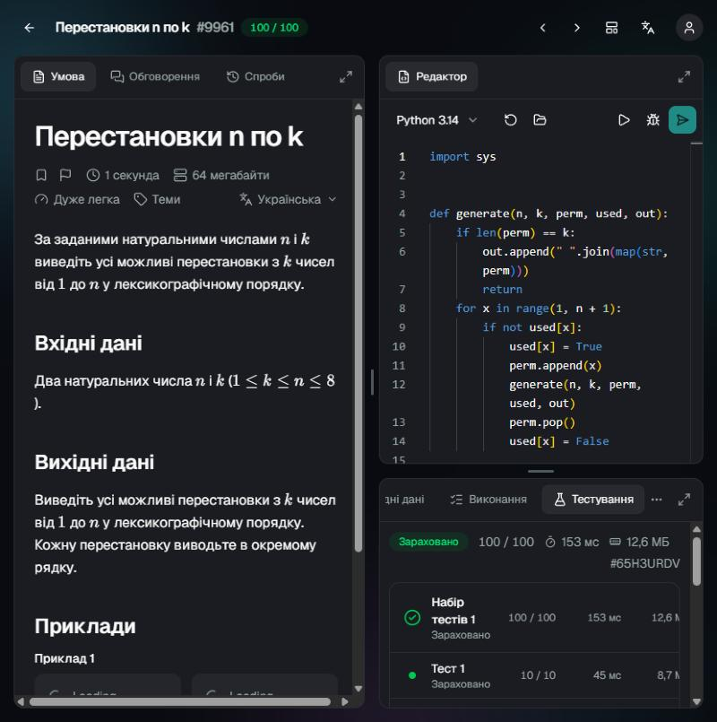
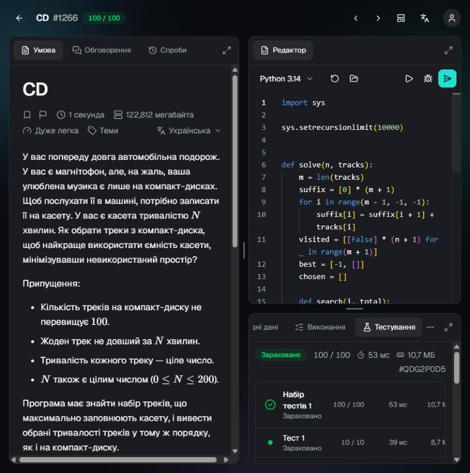
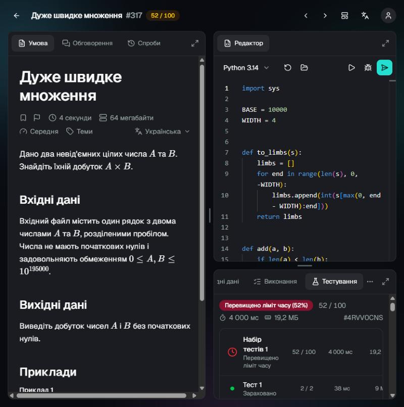

# Алгоритми і структури даних. Лабораторні роботи 10–11. Повний перебір

Сторонні бібліотеки перебору (itertools тощо) не використовуються.

| Задача | Eolymp | Код | Результат |
|---|---|---|---|
| 10.4. Перестановки n по k | [9961](https://eolymp.com/uk/problems/9961) | [t10_04_e9961.py](t10_04_e9961.py) | 100% |
| 10.5. CD | [1266](https://eolymp.com/uk/problems/1266) | [t10_05_e1266.py](t10_05_e1266.py) | 100% |
| 11.4. Дуже швидке множення | [317](https://eolymp.com/uk/problems/317) | [t11_04_e317.py](t11_04_e317.py) | 52% (очікувано 20%) |

---

## 10.4. Перестановки n по k
Рекурсивний перебір з поверненням: на кожному кроці пробуємо поставити на наступне місце кожне ще не використане число від 1 до n у порядку зростання. Коли довжина перестановки дорівнює k, записуємо її. Оскільки числа перебираються за зростанням, перестановки виходять у лексикографічному порядку.

## 10.5. CD
Повний перебір підмножин треків: для кожного треку розглядаємо два варіанти — записати його на касету (якщо вміщається) або пропустити. Перебір скорочується відсіканнями: якщо навіть усі решта треків не покращать найкращий результат; якщо касету вже заповнено повністю; якщо стан (номер треку, зайнятий час) вже було розглянуто.

## 11.4. Дуже швидке множення
Множення Карацуби. Числа зберігаються як масиви «цифр» за основою 10⁴. Кожне число ділимо навпіл: A = A₁·Bʰ + A₀, B = B₁·Bʰ + B₀, і замість чотирьох множень половин робимо три: A₀B₀, A₁B₁ та (A₀+A₁)(B₀+B₁). Для коротких масивів (≤ 32 цифр) використовується шкільне множення. Складність O(n^log₂3) ≈ O(n^1.585). Частина великих тестів на Python не вкладається в ліміт часу.

